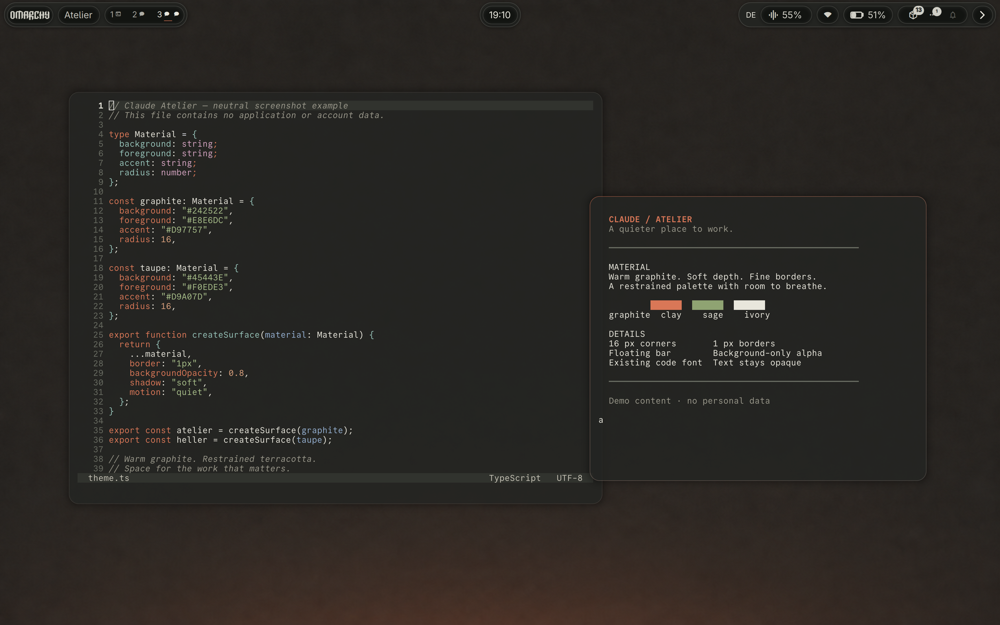
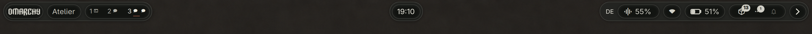

# Claude Atelier

A warm, dark glass-inspired desktop with ivory text and restrained terracotta accents. Built from the Claude Dark palette for **Omarchy 4, Quickshell and Lua-based Hyprland**.



## Screenshots

Real desktop captures with neutral demo windows, taken on 2026-09-06. These show the locally customized setup with Shibumi and the optional Atelier widgets, not the result of installing the theme alone. See [Bar and optional extras](#bar-and-optional-extras) for the additional setup and Omarchy's theme-install limits.



[Workspace detail](screenshots/bar-workspaces.png) · [Bar controls](screenshots/bar-controls.png) · [Calendar panel](screenshots/calendar.png) · [Capture details](screenshots/README.md) · [Text-free wallpaper](backgrounds/1-claude-quiet-graphite.png)

## Design

Quiet graphite/taupe, 16 px corners, fine borders, soft shadows and short transitions. Terminals use 80% background opacity; text stays opaque. Designed to complement a restrained Shibumi split bar.

Your existing terminal and code fonts are preserved. Heller means “brighter”; it is not a white/light-mode theme.

## Install

For a new installation:

```sh
omarchy theme install https://github.com/unusepluribus/omarchy-claude-atelier-theme.git
```

Already installed? Select it in Omarchy's theme menu or run:

```sh
omarchy theme set claude-atelier
```

**Back up an existing theme directory first.** The installed Omarchy theme installer may replace a directory with the same name. Do not use the install command to replace an existing project symlink; update that checkout instead.

## Bar and optional extras

Installing from Git applies the palette, wallpaper and shell theme tokens. It **does not replace your bar, rearrange widgets, install plugins or change your code font**.

**Omarchy's trust boundary:** on the tested version, Git-installed themes do not load bundled Lua or terminal configuration. Omarchy regenerates those files from the palette, so the advertised blur, corner geometry and terminal opacity require separate, reviewed local customization. The presence of these files in the repository is not a promise that the normal install command applies them.

For the full styling, inspect `hyprland.lua` and the configuration for your terminal, then transfer only the desired settings into a backed-up local configuration or a separate user-owned theme. Do not blindly replace your terminal configuration or delete a clone's `.git` directory to bypass the filter. The optional hooks and plugins also require explicit installation.

For the intended split-bar presentation, install [Shibumi Shell](https://github.com/HANCORE-linux/Shibumi-Shell) using its own instructions, choose V1/Shibumi, enable the two region boundaries, and keep only the groups you need. The native Shibumi bar is matte; glass comes from the terminal backgrounds and supported Omarchy overlays. The [Atelier Drawer](https://github.com/unusepluribus/omarchy-atelier-drawer) is a separate optional plugin.

The dark Atelier repository includes two optional local plugins in `extras/plugins/`:

- `trismegistos.atelier`: Adwaita Sans for shell UI only, active only in Atelier themes. It never changes Fontconfig aliases, terminal fonts or editor fonts.
- `trismegistos.atelier-workspaces`: subtle workspace indicators with monochrome app glyphs, up to four per workspace plus an overflow count, and window-title tooltips. Derived from Decent Workspaces; its MIT license is retained. The glyph font is CommitMono Nerd Font Mono; use an installed Nerd Font if adapting it.

Workspace labels and tooltips are English. Under Shibumi, the widget fits the native slot height with compact side padding; the active workspace uses a fine accent underline, not a second filled capsule. Settings survive disabling/re-enabling via a private file under `$XDG_STATE_HOME/omarchy/atelier-widgets/`.

These extras are opt-in. Copy the desired plugin folder into `~/.config/omarchy/plugins/` only if that destination does not already exist, then run `omarchy-shell shell rescanPlugins` and `omarchy plugin enable <plugin-id>`. A normal theme installation does not install these plugins.


`extras/sync-foot-background-opacity` is an optional theme-set hook for updating already-open Foot terminals. Review it before installing it with `omarchy hook install theme-set /absolute/path/to/extras/sync-foot-background-opacity`. Without the hook, open a new Foot window to pick up its startup alpha settings.

## Compatibility and limits

Tested locally on 2026-09-06 with Omarchy-dev 4.0.0.r6673.g5939caf-1, Hyprland 0.56.1-3 and Quickshell 0.3.0.r20.g28771c7-2; one laptop display at 2× scaling. This release targets the newer Lua/Quickshell configuration, not legacy Hyprland `.conf` or Waybar setups. Optional Shibumi integration was tested with 0.1.1-beta.11 and remains version-sensitive.

TOML and Lua syntax were checked. More monitors and different Omarchy versions need testing. Not every application implements transparent backgrounds.

## Wallpaper, license and related themes

The wallpaper is a completely text-free matte background in warm graphite, shared with the corresponding Claude themes. It was edited with AI image generation to remove the previous wordmark. Its native size, final edit prompts and earlier provenance are in [WALLPAPER.md](WALLPAPER.md); it is not 4K. Theme code uses the MIT license. The upstream notice for the earlier image reference is retained in [THIRD_PARTY_NOTICES.md](THIRD_PARTY_NOTICES.md).

[Claude Glass](https://github.com/unusepluribus/omarchy-claude-glass-theme) · [Glass Heller](https://github.com/unusepluribus/omarchy-claude-glass-heller-theme) · [Claude Atelier](https://github.com/unusepluribus/omarchy-claude-atelier-theme) · [Atelier Heller](https://github.com/unusepluribus/omarchy-claude-atelier-heller-theme)

Independent community themes; not affiliated with Anthropic or Apple.
